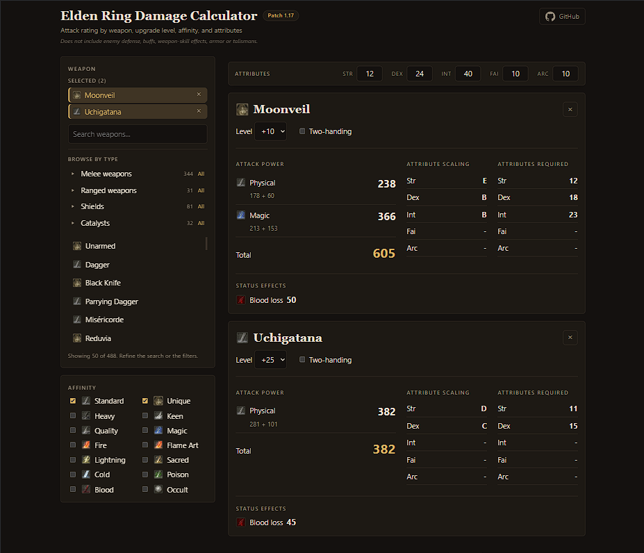

# Elden Ring Damage Calculator

[](https://github.com/Raed-Jani/soulslike-build-planner/actions/workflows/deploy.yml)

**Live demo: https://raed-jani.github.io/soulslike-build-planner/**

A free, open-source attack rating calculator for Elden Ring. Pick any weapon, set its upgrade level and your attributes, and see the damage per type, status buildup and spell scaling, all calculated in your browser. Pick several weapons to compare them one under the other.


 

## Features

- **Manual A/B stat comparison**: duplicate your attributes, redistribute points independently, and compare AR, damage types and individual buildups with independent upgrade levels and handing modes for the same weapon. Shows offensive attribute totals and requirement changes, without recommending a winner. Both configurations are shareable; see [`docs/stat-comparison.md`](docs/stat-comparison.md).
- **Phone-friendly comparison workflow**: collapsible weapon browsing and filters, a jump to results, a compact sticky attribute bar, and larger touch controls. Shared comparisons open directly to their results on small screens.
- **Shareable comparisons**: copy a versioned link containing your attributes, weapons, upgrade levels and handing modes, or bookmark it to restore the comparison. Weapon identifiers survive dataset reordering; see [`docs/share-links.md`](docs/share-links.md).
- **Attack rating per damage type** (physical, magic, fire, lightning, holy), shown as base + scaling bonus, with a total that follows the game's rounding
- **Upgrade levels** with the right maximum for each weapon (+25 regular, +10 somber)
- **Two-handing**, including the special cases: paired weapons get no bonus, and light bows, bows, greatbows and ballistae are always two-handed
- **Requirement penalties**: unmet stats reduce the affected damage types, with a visible warning
- **Status buildup** (poison, scarlet rot, blood loss, frostbite, sleep, madness, death blight), with Arcane scaling where the game applies it
- **Spell scaling** for glintstone staves and sacred seals, per element
- **Scaling grades and required attributes** for every weapon
- **Search and filters**: by name, by weapon type (melee, ranged, shields, staves and seals, other) and by affinity (Standard, Unique, Heavy, Keen, Quality, Magic, Fire, Flame Art, Lightning, Sacred, Cold, Poison, Blood, Occult)
- **Shadow of the Erdtree weapons** are included and tagged

**Not included:** enemy defense and damage against a specific enemy, temporary buffs, weapon skill effects, armor and talismans. Spell scaling is the multiplier on spell power, not the damage of a specific spell. Only the vanilla game data of patch 1.17 is used.

## How accurate is it

- The calculation engine was compared with **the calculation code of an existing open-source calculator on every one of the 3,296 weapons** in the data: damage per type, status buildup and spell scaling, at three upgrade levels, seven attribute sets, one-handed and two-handed. That is 1,667,302 comparisons with 0 differences.
- Specific builds were also checked by hand against the live calculator at [eldenring.tclark.io](https://eldenring.tclark.io) (for example the Uchigatana, Moonveil and Finger Seal).
- Unit tests cover the formulas with hand-calculated values and real weapons. The deploy pipeline runs the type check and the tests before it publishes.

This shows that the engine reproduces a widely used community calculator working from the same game data. It is not a check against the game itself.

The maths is written out step by step in [`docs/formula.md`](docs/formula.md).

## Run it locally

```bash
npm install
npm run dev      # open the address it prints (it ends with /soulslike-build-planner/)
npm test         # unit tests
npx tsc --noEmit # type check
npm run build    # production build into dist/
```

## Project structure

```
src/
  calculateAR.ts         attack rating, status buildup and spell scaling (pure functions, no UI)
  engine/buildWeapon.ts  turns raw game data into typed weapon objects
  regulationData.ts      types describing the game data file
  weapon.ts, attributes.ts, curves.ts   core types
  ui/                    React app: components, filters, styles
public/data/             game parameter data (patch 1.17, vanilla)
public/img/game/         icons (see Credits)
scripts/                 data extraction and verification tools
docs/formula.md          the formulas, with worked examples
```

The game stores its data as linked tables. A build step joins them (base damage and scaling per upgrade level, which stats feed which damage type, and the curves that turn a stat into a bonus), and the engine combines the result with your attributes.

## Verifying against the reference calculator

`scripts/compareAll.ts` runs this engine and the reference calculator's own code on every weapon and reports any difference. It needs the reference repository cloned **next to this project**:

```bash
cd ..
git clone https://github.com/ThomasJClark/elden-ring-weapon-calculator.git reference-calculator
cd soulslike-build-planner
npx tsx scripts/compareAll.ts
```

The app, the tests and the other scripts do not need that clone.

## Credits and disclaimer

- Weapon data (`regulation-vanilla-v1.17`) and the scaling-curve evaluation come from [elden-ring-weapon-calculator](https://github.com/ThomasJClark/elden-ring-weapon-calculator) by Tom Clark (MIT License, full text in `THIRD_PARTY_LICENSE-elden-ring-weapon-calculator.txt`).
- The icons in `public/img/game/` are ELDEN RING assets (c) FromSoftware / Bandai Namco, taken from the elden-ring-weapon-calculator project. They are **not** covered by this repository's MIT license, and they will be removed on request.
- ELDEN RING, its game data, names and icons belong to FromSoftware / Bandai Namco. This is a fan-made, non-commercial project and is not affiliated with or endorsed by either company.

## License

MIT, see [`LICENSE`](LICENSE). Third-party material keeps its own license, as described above.
