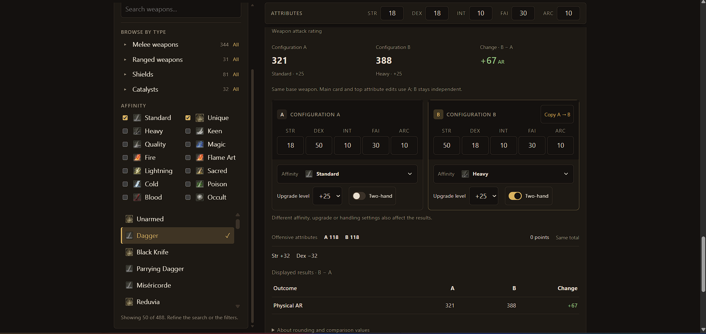

# Elden Ring Damage Calculator

[](https://github.com/Raed-Jani/soulslike-build-planner/actions/workflows/deploy.yml)

**[Open the live calculator](https://raed-jani.github.io/soulslike-build-planner/)**

A free, open-source Elden Ring calculator for two practical questions: **Which weapon suits my attributes?** and **How do different configurations affect the same weapon?** Compare multiple weapons using shared attributes, or experiment with independent A/B attributes, affinities, upgrade levels and handling for one weapon. Explore attack rating, status buildup and spell scaling, all calculated in your browser with no account or backend required. Built with React, TypeScript and Vite.


## Features

- **Compare different weapons**: select multiple weapons and inspect their result cards together using your shared attributes. Each weapon has its own upgrade and handling settings, with attack rating, requirements, scaling and applicable buildup or spell scaling available for comparison.
- **Compare configurations of the same weapon**: change attributes, affinity, upgrade level and handling independently in A and B for the same base weapon. Compare AR, damage types, individual buildups and spell scaling with signed differences. Offensive attribute totals and requirement changes provide context without declaring a universal winner. Copy A to B to start another experiment; see [comparison details](docs/stat-comparison.md).
- **Affinity scaling previews**: expand either comparison affinity picker to see available affinities, icons and STR/DEX/INT/FAI/ARC scaling grades at that configuration's upgrade level.
- **Phone-friendly comparison workflow**: collapsible weapon browsing and filters, a jump to results, a compact sticky attribute bar, and larger touch controls. Shared comparisons open directly to their results on small screens.
- **Shareable comparisons**: capture selected weapons, shared attributes and both A/B configurations, including affinities, upgrade levels and handling. Versioned links use weapon identifiers that survive dataset reordering. Editing the setup hides the old generated link so you can create an updated one; see [share-link format and compatibility](docs/share-links.md).
- **Weapon wiki links**: open a weapon's Elden Ring Wiki page from its name for information beyond the calculator.
- **Attack rating per damage type** (physical, magic, fire, lightning, holy), shown as base + scaling bonus, with a total that follows the game's rounding
- **Upgrade levels** with the right maximum for each weapon (+25 regular, +10 somber)
- **Two-handing**, including the special cases: paired weapons get no bonus, and light bows, bows, greatbows and ballistae are always two-handed
- **Requirement penalties**: unmet stats reduce the affected damage types, with a visible warning
- **Status buildup** (poison, scarlet rot, blood loss, frostbite, sleep, madness, death blight), with Arcane scaling where the game applies it
- **Spell scaling** for glintstone staves and sacred seals, per element
- **Scaling grades and required attributes** for every weapon
- **Search and filters**: by name, by weapon type (melee, ranged, shields, staves and seals, other) and by affinity (Standard, Unique, Heavy, Keen, Quality, Magic, Fire, Flame Art, Lightning, Sacred, Cold, Poison, Blood, Occult)
- **Shadow of the Erdtree weapons** are included and tagged

**Not included:** enemy defense and damage against a specific enemy, temporary buffs, weapon skill effects, armor and talismans. Spell scaling is the multiplier on spell power, not the damage of a specific spell. Only the vanilla game data of patch 1.17 is used.

## Compare different weapons

Search for and select **Uchigatana** and **Nagakiba**, then set your attributes in the shared bar. Both weapon cards use those attributes, so you can inspect their attack rating, requirements, scaling and blood-loss buildup together. Adjust each weapon's upgrade level and handling as needed. Remove a weapon from the selected list or its card when you finish comparing it.

This helps compare calculated weapon output for your attributes. Reach, weight, movesets and attack speed are not evaluated, so the calculator does not choose a universally best weapon.

## Compare configurations of the same weapon

For example: **How does a Strength-focused Heavy Uchigatana compare with a Dexterity-focused Keen Uchigatana at equal offensive investment?**

1. Search for **Uchigatana**, select it, and choose **Compare another stat distribution** on its card.
2. Set A to **Heavy**, with STR 50 and DEX 18. Set B to **Keen**, with STR 18 and DEX 50. Keep INT, FAI and ARC identical.
3. Set both upgrade levels to **+25** and use the same two-hand setting. This keeps upgrade and handling differences out of this experiment.
4. Check the offensive attribute totals and requirement warnings, then compare attack rating and buildup separately. Expand an affinity picker to inspect its scaling grades.
5. Choose **Share comparison** to capture the setup in a link. After changing the setup, press Share again to generate an updated link.

The top attribute bar updates A in open comparisons; B remains independent. **Copy A → B** copies A's attributes and settings once. Collapsing the section preserves both configurations; the **×** button discards them and returns to shared attributes.

Equal offensive totals do not mean equal character levels. Meeting a requirement can remove a penalty, so that gain is distinguished from ordinary scaling. AR, buildup and spell scaling are separate outcomes: a larger value in one does not make a build universally better. Spell-scaling differences use percentage points, not a percentage increase in final spell damage.



*Comparing two stat distributions with equal offensive attribute totals. The +67 AR difference reflects changes in attributes, affinity and two-handing.*

## How accurate is it

- The calculation engine was compared with **the calculation code of an existing open-source calculator on every one of the 3,296 weapons** in the data: damage per type, status buildup and spell scaling, at three upgrade levels, seven attribute sets, one-handed and two-handed. That is 1,667,302 comparisons with 0 differences.
- Specific builds were also checked by hand against the live calculator at [eldenring.tclark.io](https://eldenring.tclark.io) (for example the Uchigatana, Moonveil and Finger Seal).
- Unit tests cover the formulas with hand-calculated values and real weapons. Golden integration tests exercise the runtime weapon builder and calculation engine together; see [golden-test methodology](docs/golden-tests.md). The deploy pipeline runs the type check and tests before publishing.

This shows that the engine reproduces a widely used community calculator working from the same game data. It is not a check against the game itself.

The maths is written out step by step in [`docs/formula.md`](docs/formula.md).

## Run it locally

```bash
npm install
npm run dev      # open the address it prints (it ends with /soulslike-build-planner/)
npm test         # tests in watch mode
npm run test:run # run the existing test suite once
npm run typecheck # TypeScript checks
npm run build    # production build into dist/
npm run preview  # serve the production build locally after building
```

## Project structure

```
src/
  calculateAR.ts         attack rating, status buildup and spell scaling (pure functions, no UI)
  engine/buildWeapon.ts  turns raw game data into typed weapon objects
  engine/compareDistributions.ts  compares two configurations using the calculation engine
  regulationData.ts      types describing the game data file
  weapon.ts, attributes.ts, curves.ts   core types
  ui/                    React app: components, filters, styles
public/data/             game parameter data (patch 1.17, vanilla)
public/img/game/         icons (see Credits)
scripts/                 data extraction and verification tools
docs/formula.md          the formulas, with worked examples
```

The game stores its data as linked tables. The runtime weapon builder joins base damage, upgrade scaling, attribute dependencies and scaling curves into typed weapon objects. The pure calculation engine combines these with your attributes; React handles editing, presentation and share links. The comparison engine evaluates A and B separately through the same calculation code.

Technical documentation: [formulas](docs/formula.md) · [A/B comparison behavior](docs/stat-comparison.md) · [versioned share links](docs/share-links.md) · [golden integration tests](docs/golden-tests.md).

## Verifying against the reference calculator

`scripts/compareAll.ts` runs this engine and the reference calculator's own code on every weapon and reports any difference. It needs the reference repository cloned **next to this project**:

```bash
cd ..
git clone https://github.com/ThomasJClark/elden-ring-weapon-calculator.git reference-calculator
cd soulslike-build-planner
npx tsx scripts/compareAll.ts
```

The app, the tests and the other scripts do not need that clone.

## Credits and disclaimer

- Weapon data (`regulation-vanilla-v1.17`) and the scaling-curve evaluation come from [elden-ring-weapon-calculator](https://github.com/ThomasJClark/elden-ring-weapon-calculator) by Tom Clark (MIT License, full text in `THIRD_PARTY_LICENSE-elden-ring-weapon-calculator.txt`).
- The icons in `public/img/game/` are ELDEN RING assets (c) FromSoftware / Bandai Namco, taken from the elden-ring-weapon-calculator project. They are **not** covered by this repository's MIT license, and they will be removed on request.
- ELDEN RING, its game data, names and icons belong to FromSoftware / Bandai Namco. This is a fan-made, non-commercial project and is not affiliated with or endorsed by either company.

## License

MIT, see [`LICENSE`](LICENSE). Third-party material keeps its own license, as described above.
